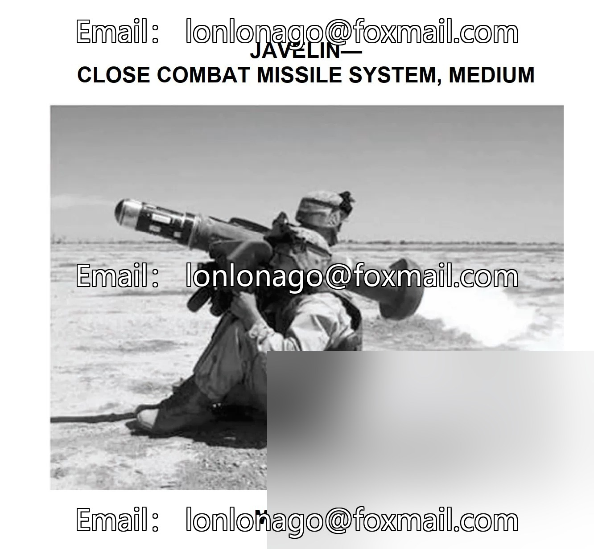
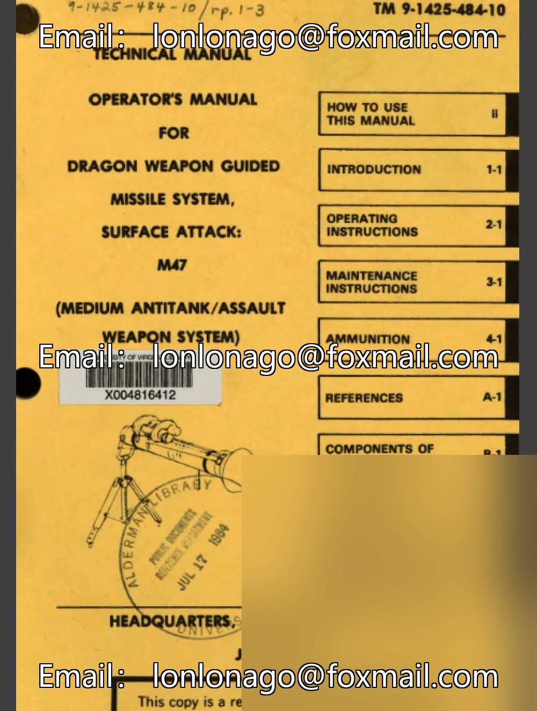
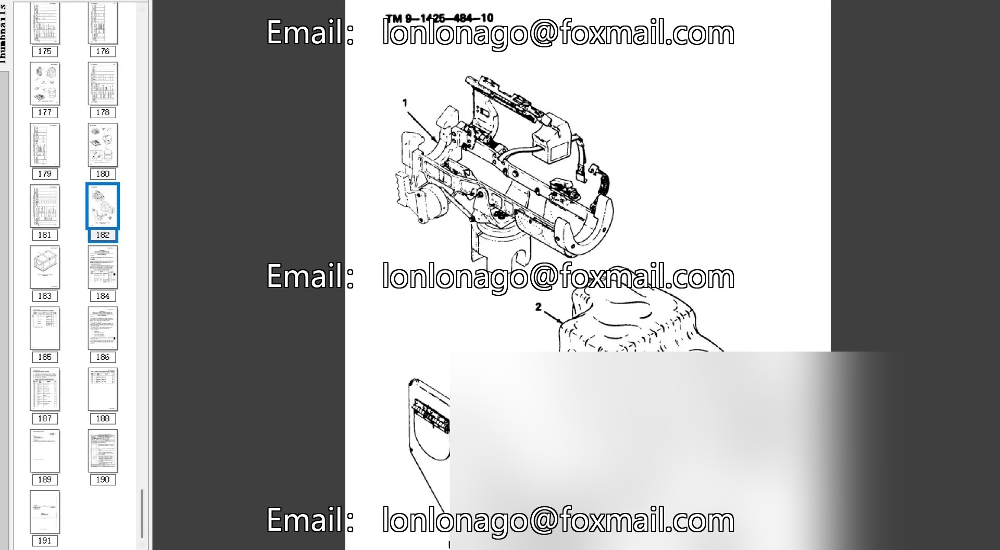
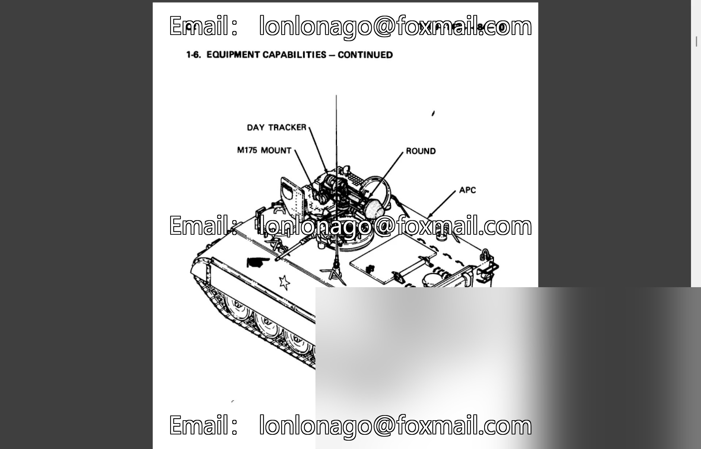
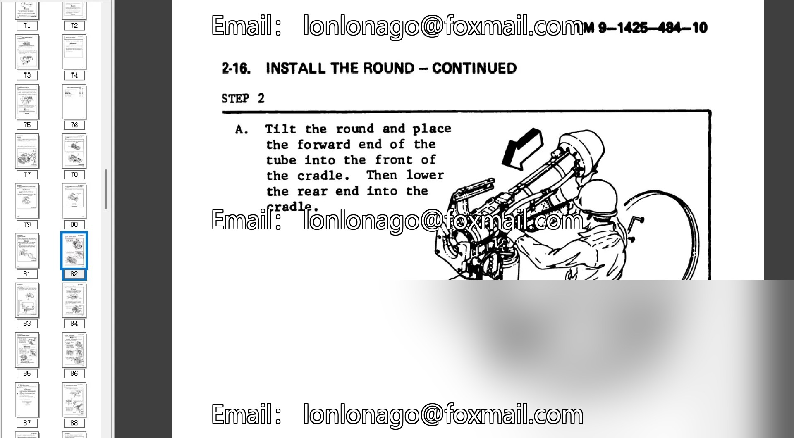
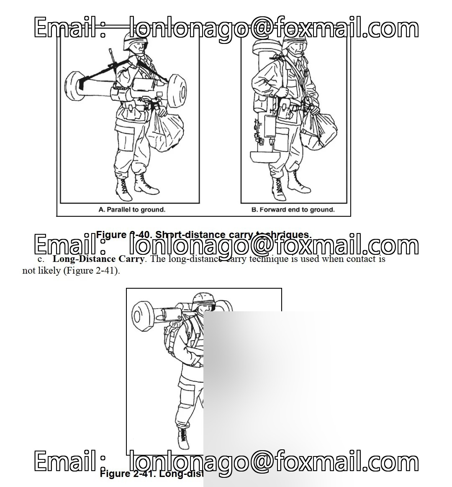
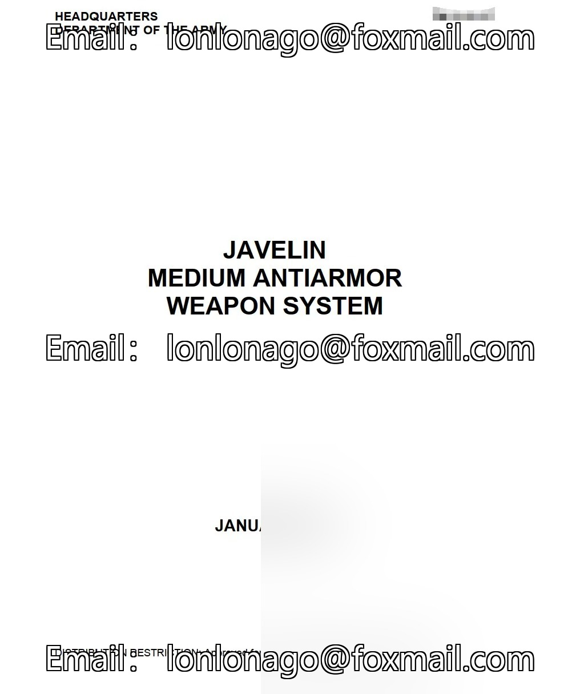
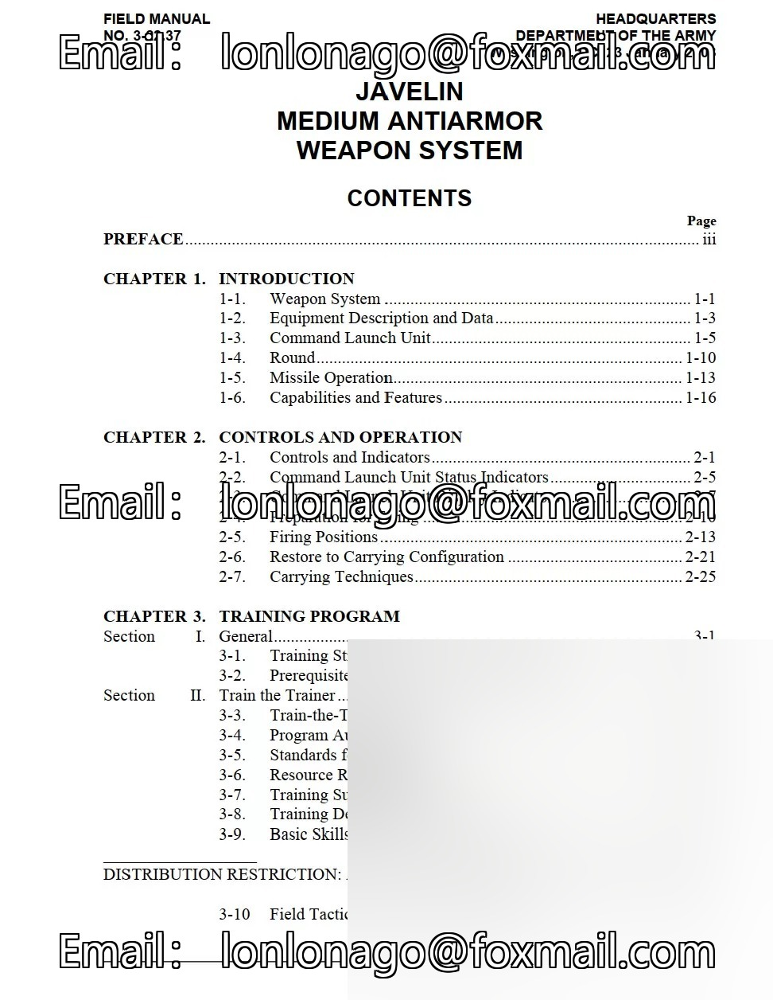
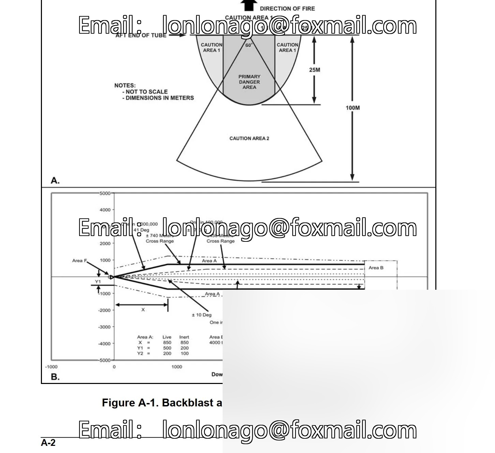

# The operating manual for the US Javelin (pole) medium anti-tank weapon system (200)

## Body

The Operation Manual for the American Javelin (spear) Medium Anti-Tank Weapon System (2003).
Core content:
《JAVELIN MEDIUM ANTIARMOR WEAPON SYSTEM》
Comprehensive operation instructions, maintenance, tactical usage, and other aspects.
The original technical manual of the United States Army, published in a public release version.
are copyable and cannot be refunded upon sale.

The manual covers the operation of the US Javelin medium anti-tank weapon system, maintenance, and tactical application.

<!-- AI_ENRICHED -->

## Images

## Payment

Here is a pay link on Stripe ( https://buy.stripe.com/3cs8yP7sY87d0vu9AB ). Please contact me lonlonago@foxmail.com after funding $89, and I will send you a complete data files , thank you!

